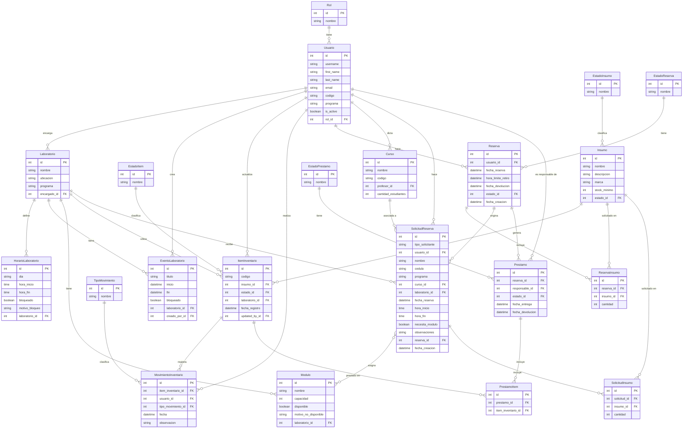

# Diagrama Entidad-Relación — Sistema de Laboratorios

Este diagrama refleja el estado actual del modelo de datos del proyecto `sistema_laboratorios`, generado a partir de la lectura directa de los archivos `models.py` de las apps `users`, `laboratorio`, `inventario`, `reservas`, `solicitudes` y `prestamos`.

**Fecha de generación:** 2026-06-18

> Nota: `SolicitudReserva.reserva` es una FK simple (no `unique=True`) hacia `Reserva`, por lo que estructuralmente permite varias solicitudes por reserva; en la práctica del negocio cada solicitud genera y referencia una única reserva propia (relación 1:1 de uso). Por fidelidad al código se representa como uno-a-muchos (`Reserva ||--o{ SolicitudReserva`). Lo mismo aplica para `Prestamo.reserva`, que tampoco tiene restricción `unique`.

